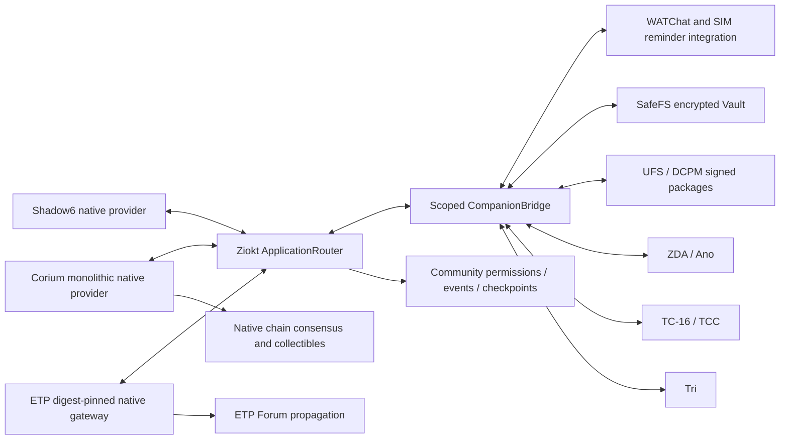

# Federation audit continuation — 2026-10-15

This supplement preserves the earlier verification in `verification-current.json`.
That report describes its pinned revisions, not the newly modified sources.
GitHub Actions became available again after an initial account billing refusal.
At `d8c9e7d`, minimal and integrated ETP compilation and Rust library tests passed;
the actual integrated Forum gateway restart smoke failed and remains under repair.
The full Python suite exposed a test-process AirGap latch, now isolated in a child
without weakening the production policy. The public Tor gate also failed; that
failure is tracked separately from local isolated-network interoperability.
No local Cargo build/check/test was substituted. Universal v3 is newly enabled
and awaits its first CI compilation and test execution.

## Actual component boundaries

All eleven catalog targets retain the common application entry. A typed route
is an authorization boundary, not proof that every optional legacy service is
complete. ETP Forum, Community Forum and Corium consensus remain separate.
Existing encrypted component exchange does not execute received packages or
turn recipients into trusted contacts automatically.

## Fix and evidence index

| Area | Corrected behavior / evidence |
| --- | --- |
| ETP Forum | Real author signatures, identity binding, full-field IDs, bounded durable storage, actual push/fetch/inventory, fragmentation; see `../companions/etp/src/docs/FORUM_V2.md` |
| ETP routing | External anonymity defaults to tunnel-only, explicit hybrid opt-in; strict SideChannel admission rejects unknown channels |
| Community | Authenticated live inventory repairs stale delivery receipts; manifest plaintext verification; failed-checkpoint key rollback; revoked mailbox denial; see `COMMUNITY-AUDIT-2026-10.md` |
| WATChat / SIM | Durable verified-message ACK ordering and first-key creation race; see `COMPANION-AUDIT-2026-10-15.md` |
| ZKN / ZKC | Transaction token bound to signed snapshot, bounded malformed-input rejection; see `COLLECTIBLES-AUDIT-2026-10.md` |
| Ano / TC-16 | Malformed evidence rejection and explicit different ABIs; see `TC16-ANO-AUDIT-2026-10-15.md` |
| Shared native crypto | Wrong key/signature/message types and oversized key/signature rejected as `NATIVE_SIGNATURE_REJECTED`; generated copies synchronized from `spec/data_runtime.py` |
| Effort website | Durable prepared-intent restart recovery; expired prepared intent is aborted before retry, unknown execution never blindly retried; see `EFFORT-RECOVERY-2026-10-15.md` |
| Chain explorer | Real bounded read-only canonical-chain view, block/transaction navigation and public HTTPS; see `CHAIN-EXPLORER.md` |
| Corium Engine Zero | Challenge deadline initialization fixed, native inclusion/rebuild regression; block commit no longer falsely reports completed broadcast |

## Failure model

The added Community matrix uses three independent databases/CAS directories and
three real TLS listeners in one test process. Six directed links are interrupted
through actual local proxy sockets. It covers offline concurrent forum branches,
child-before-parent rejection, duplicate delivery, reconnection, same-endpoint
database restart and cold checkpoint recovery. It is not a three-process test
of the Corium consensus engine and does not establish all-companion availability.

The native Corium tests exercise actual TLS block/object retrieval, signed
transactions, competing branches, atomic reorganization and crash recovery.
A depth-based confirmation is not irreversible global finality. The existing
validator selection and fork rules are retained. Neither retained backups nor
an independently running single validator prove the original network is online.

## Scan classification

- **A/B — real defects / incomplete advertised execution:** the fixes above and
  concrete native UFS/DCPM findings, each with bounded negative tests.
- **C — explicit design mechanisms:** bootstrap simulator; frame-length fields
  temporarily reserved while constructing bytes; hardware MMIO conventions.
  They must not be described as authenticated remote execution or live peers.
- **D — historical source:** `companions/*/original` is preserved input, not the
  active safe runtime. Security fixes target active `src` and Ziokt adapters.
  Archived dependency alerts are not claimed to have disappeared.
- **E — outside current product:** no new currency, fee, PoW consensus,
  global-traffic-analysis guarantee or automatic cross-forum identity bridge.

Known incomplete optional native adapters are recorded in their component
supplements. A gateway returning 501 or an absent DHT GET/ACK interface is not a
successful fetch or durable remote replica. No claim of exhaustive audit or
complete ecosystem acceptance is made while these execution/verification gaps
remain.

## Deployment

The requested separate production chain and public effort site are deployed
outside the repositories. `/home/admin/fendou.txt` contains access, services,
state locations and verified inclusion information. No production state, private
keys, certificates or browser subscriptions belong in a source delivery archive.

## Additional product integration

* UFS/DCPM: 12 real HTTP/TLS and signed-package product tests passed, 0 failed,
  0 skipped (8.344 s). Optional legacy libp2p, file-chain, IPFS and Torrent are
  not covered; see `UFS-NATIVE-HTTP-2026-10.md`.
* ApplicationRouter / persistent JSONL serve / typed Forum adapter: 9 tests
  passed (13.090 s). Real native Forum restart is a separate failing CI gate.
* ZKN delivery v2: padded mTLS capsules, per-delivery grants and persisted mix
  scheduling reduce transport linkage; public chain ownership remains linkable.
  See `ZKN-DELIVERY-PRIVACY-V2.md` for the actual privacy boundary.
* Universal v3 authenticates all protected fields, uses actual connected peers,
  bounded exact inventory and persisted read deadlines. It is not evidence of
  a remote KNS/DHT retrieval service; see the native `UNIVERSAL_V3.md` document.
