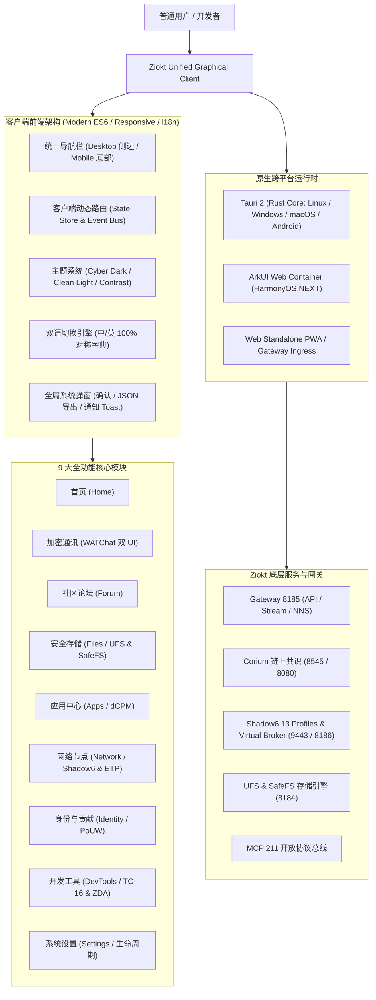

# Ziokt 跨平台统一图形客户端用户指南与架构手册 (Ziokt Unified GUI Manual)

> **版本**: 1.0.0-GA  
> **适用平台**: Linux (x86_64, arm64), Windows (x64), Android (APK), HarmonyOS NEXT (ArkUI), macOS / iOS, Web (PWA)  
> **代码仓库**: `gui/` & `gateway/gui/`  
> **网关集成**: `/app/gui` (控制台入口) & `/gateway-assets/gui/` (Web 客户端静态资源)

---

## 1. 系统概述与设计理念

Ziokt 统一图形客户端（Ziokt Unified Graphical Client）是 Ziokt 生态从传统 Web 控制台、MCP 命令行和独立 Companion 升级为普通用户与专业开发者均可直接安装使用的综合应用。

### 1.1 核心设计原则
1. **真实客户端而非空壳网页**: 拥有统一的导航路由、任务进度监视、对话确认框、文件对话框、错误恢复机制与组件生命周期调度。
2. **零终端普通用户体验**: 普通用户不需接触命令行即可完成加密聊天、安全文件传输、去中心化论坛浏览、dCPM 软件包安装与版本回滚。
3. **保留专业深度与原生安全**: 高级用户仍可操作 Shadow6 13 种 Profile 核心矩阵、粘贴解析 S6P1 信封、单步调试 TC-16 16 位虚拟机、验证 ZDA 多项式零知识门；所有操作严格复用 Gateway 现有的安全鉴权与 0600 权限边界。
4. **全端原生与无缝兼容**: 优先支持 Linux、Windows、Android，支持 macOS/iOS，并通过 ArkUI Web 容器原生兼容华为 HarmonyOS NEXT。

---

## 2. 系统架构



---

## 3. 核心功能与使用指南

### 3.1 首页 (Home Dashboard)
- **集群状态与指标**: 实时监控 Corium 区块链高度、DHT 节点拓扑、dCPM 软件包与 Shadow6 活跃核心。
- **运行模式快速切换**:
  - **Local (本地优先)**: 适用于拥有完整节点的主机，直接调度本机服务。
  - **Remote (远程网关)**: 适用于轻量客户端或移动设备，安全穿透远端 HTTPS 网关。
  - **Hybrid (混合模式)**: 本地执行敏感私钥与加密，远端同步大容量媒体和区块状态。
- **快捷任务卡片**: 一键发起加密对话、存入 SafeFS 密室、打开开发套件。

### 3.2 加密通讯 (WATChat 双 UI 模式)
- **简洁版 (Minimalist)**: 专注于流畅无干扰的快速消息沟通，极简输入条与高对比度气泡，特别适合移动设备。
- **经典丰富版 (Classic Rich)**: 展示 Ed25519 签名指纹、SafeFS 密室附件直通、群组广播信道与加密算法状态。
- **零中断切换**: 用户随时在顶部点击切换按钮，聊天历史记录、输入缓冲区与端到端安全会话实时保留，不会发生刷新或掉线。

### 3.3 社区论坛 (Forum)
- **去中心化主题列表**: 支持按 `全部`、`技术`、`治理提案`、`节点维护` 分类检索。
- **密码学签名发帖**: 发帖时由客户端本地生成 Ed25519 签名并通过 Gateway Nonce 防重放机制安全提交。
- **多语言响应**: 主题发布时间自动转换本地化时间戳。

### 3.4 安全文件管理 (Files / SafeFS / UFS)
- **双重金库支持**:
  - **UFS (去中心化内容存储)**: 支持任意类型文件的内容寻址分片与 SHA-256 根哈希计算。
  - **SafeFS (隐形安全存储)**: 硬件级密封与隐形卷状态检测。
- **拖拽与交互**: 支持文件拖拽直接计算 Merkle 分片并上传，提供下载直链与防误触确认删除弹窗。

### 3.5 应用中心 (Apps / dCPM)
- **软件包生命周期管理**:
  - **安装 (Install)**: 校验数字签名、解析依赖关系并下载分片。
  - **更新 (Update)**: 差分更新，保持本地用户数据完整。
  - **版本回滚 (Rollback)**: 遇到意外问题可一键回退到稳定历史版本。
  - **卸载 (Uninstall)**: 干净释放存储空间，无残留垃圾。
- **依赖检查器**: 实时验证 `Corium Engine`、`Shadow6 Mesh`、`UFS Storage` 底层依赖组件的健康状态。

### 3.6 网络节点 (Network / Shadow6 & ETP)
- **13 种原生 Profile 运行矩阵**:
  - `Go (KCP)`、`Rust (QUIC)`、`Gleam (Secure-Stream)`、`Ada (Cell-Relay)`、`Nim (WebRTC)`、`Pony (UDP)`、`Zig (ENet)`、`D (Secure-Stream)`、`C++ (SCTP/TLS1.3)`、`Idris (UDP)`、`Hare (UDP)`、`Carp (UDP)`、`Gleam (Micro-Mux)`。
- **Virtual Broker 遥测**: 查看虚拟 Broker 核心（端口 `9443`）与控制中心（端口 `9467`）的健康遥测。
- **S6P1 自定义协议信封导入**:
  - 用户无需服务器管理员权限即可在客户端输入框粘贴自定义 `S6P1.ey...` 协议信封。
  - 点击“解析信封”即时反解 Base64URL 结构并展示路由节点映射与凭据模式。
  - 支持将有效信封一键保存至客户端安全配置。
- **ETP 洋葱多跳拓扑**: 实时展示 3 跳混淆电路链路与延迟 Ping 诊断。

### 3.7 身份与贡献 (Identity / PoUW)
- **去中心化身份 (DID)**: 显示本地 DID（如 `did:ziokt:...`）与公钥指纹。
- **NNS 域名解析与绑定**: 快速绑定或检索 `.cor` 去中心化域名。
- **PoUW 有用算力挖矿**: 实时监控哈希速率（如 `2,840 H/s`）、链上难度系数与未结算贡献积分。
- **白名单治理通道**: 包含申请外部链权重与奖励引擎的入口。

### 3.8 开发者工具 (DevTools)
- **TC-16 16 位虚拟机监视器**:
  - **真实仿真**: 包含通用寄存器 `R0`, `R1`, `R2`, `R3`, `R4`, `R5`，栈指针 `SP` 与程序计数器 `PC`。
  - **操作控制**: 支持单步调试（Step）、连续步进运行（Run）、虚拟机复位（Reset）与内存字节码查看。
- **Corium 账本检索器**: 查询共识高度、验证者列表与交易哈希。
- **Tri 密码学快照执行器**: 加载并运行离线隔离状态机。
- **ZDA 多项式零知识门验证器**: 离线或在线校验算术电路零知识证明。
- **MCP 211 开放协议探针**: 快速对 MCP 注册工具进行连通性与参数校验探测。

### 3.9 系统设置与生命周期管理 (Settings)
- **组件按需生命周期管理器**:
  - 支持针对 Corium、Shadow6、UFS、WATChat、ETP 进行**按需拉起**与**按需暂停**。
  - 避免在低功耗或移动端设备上强制常驻全部组件，节省系统内存与电量。
- **端点与凭据配置**: 自定义 Gateway URL 与本地端口。
- **无障碍与界面定制**:
  - 主题切换：赛博暗黑（Cyber Dark）、清爽明亮（Clean Light）、高对比度模式（High Contrast）。
  - 语言切换：简体中文（zh-CN）与 English（en-US）。
  - 键盘快捷键一览：数字键 `1-9` 快速切换模块，`Esc` 快速关闭所有弹窗，`Ctrl+K` 快速唤出搜索与命令面板。

---

## 4. 安全规范与权限边界

1. **零高权限逃逸**: 客户端所有对底层链、存储与网络的读写操作，均通过 Gateway 既有的 REST / Nonce / 签名接口执行，绝不另开不受控的 root/shell 接口。
2. **凭据本地隔离**:
   - UFS 认证配置文件位于 `~/.config/dcpm-ufs/config.json`，权限为严苛的 `0600`。
   - Shadow6 鉴权口令仅保留在用户授权的本地会话或安全加密区，不向公网暴露。
3. **真实结果反馈**: 任何安装、更新、回滚与网络连接操作均显示真实进度与状态码，杜绝伪造假成功提示。

---

## 5. 多平台打包与持续集成 (CI/CD)

项目在 `.github/workflows/gui-release.yml` 配套完整的自动化持续集成工作流：

### 5.1 CI 执行矩阵
| 任务名称 | 目标产物 | 运行平台 | 验证内容 |
|---|---|---|---|
| **test-and-validate** | 单元测试 & 端到端回归 | Ubuntu 24.04 | `node build.js` 验证，`test_gui_e2e.py` 自动化测试 |
| **build-linux** | `ziokt-desktop-linux-x86_64.tar.gz` | Ubuntu 24.04 | Linux 依赖库构建与打包 |
| **build-windows** | `ziokt-desktop-windows-x64.zip` | Windows Latest | WebView2 驱动桌面应用打包 |
| **build-android-and-harmonyos** | `ziokt-mobile-android-assets.tar.gz` / `ziokt-mobile-harmonyos-next.tar.gz` | Ubuntu 24.04 | Android 与 HarmonyOS NEXT ArkUI 包构建 |
| **publish-web-pwa** | `ziokt-web-pwa.tar.gz` | Ubuntu 24.04 | 离线 PWA 与 Gateway 嵌入包分发 |

### 5.2 本地快速构建与测试命令
```bash
# 1. 验证并构建 Web 静态资源
cd /home/admin/Ziokt/gui
node build.js

# 2. 运行本地完整端到端自动化测试套件 (包含 9 项全量断言)
python3 tests/test_gui_e2e.py

# 3. 验证 Gateway 路由连通性
curl -I https://ziokt-gateway-43-207-75-185.sslip.io/app/gui
curl -I https://ziokt-gateway-43-207-75-185.sslip.io/gateway-assets/gui/index.html
```

---

## 6. HarmonyOS NEXT (鸿蒙原生) 兼容指南

对于运行 HarmonyOS NEXT 的华为终端设备，Ziokt 提供了原生的 ArkUI 适配工程：
- **配置文件**: `gui/harmonyos/module.json5`，已配置 `ohos.permission.INTERNET` 权限与主 Ability 声明。
- **页面代码**: `gui/harmonyos/entry/src/main/ets/pages/Index.ets`。
- **工作机制**:
  - 使用原生 `Web` 组件加载沙盒离线包或部署网关。
  - 通过 `onConfirm` / `onAlert` 原生拦截器，将网页内对话框无缝转换为 HarmonyOS 原生模态确认弹窗，确保无缝体验。
