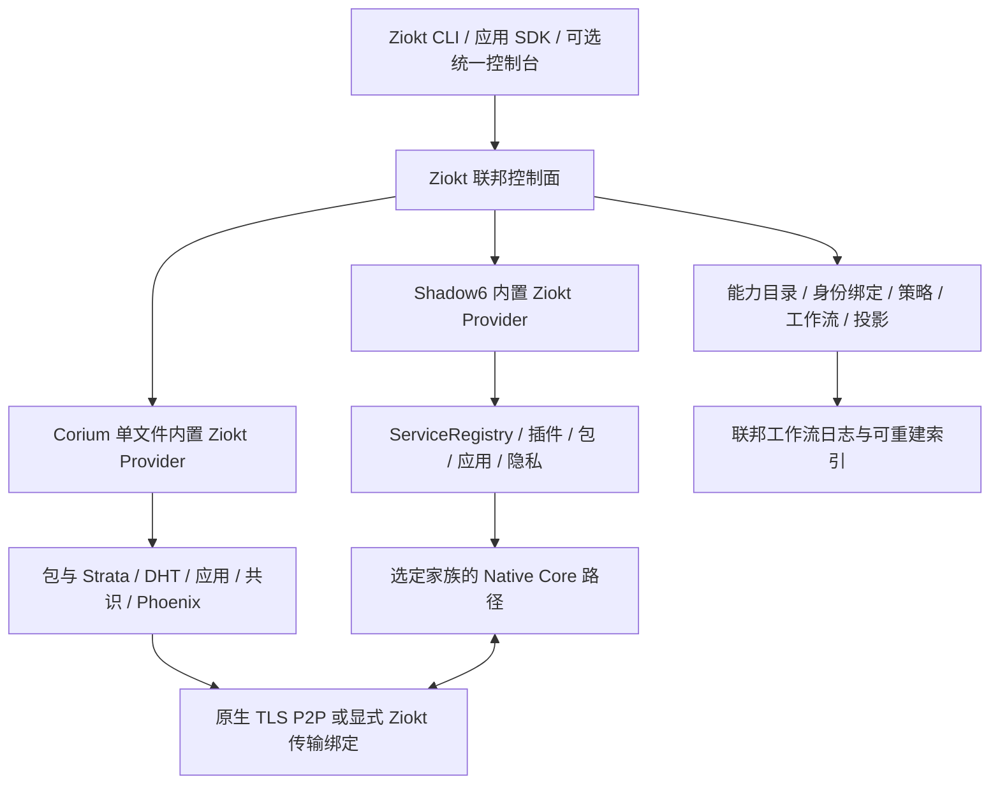

# Ziokt 联邦与深度融合设计

版本：设计草案 v0.1，2026-10-11。

源码基线：Shadow6 `5222c6c7`；Corium `37bd721`。本文来自本地源码与契约的定向阅读，未运行构建、测试或线上验证。文中“新增”“建议”“目标”均是待实现设计，不表示现有代码已经支持。

## 1. 总体决策

Ziokt 是具有独立发布、联邦控制面、公共协议和统一应用模型的新项目。Shadow6 与 Corium 是两个自治执行域，源码均增加 Ziokt 原生支持；它们通过明确的契约共同组成 Ziokt，而不是由外部脚本机械串接。

保留 Shadow6 多模块、多 Core、独立编译与原生部署；保留 Corium 一个生产 Bash 文件、内部函数和内嵌 Python 的巨石结构。二者不互相导入实现、不共享可写业务数据库、不要求另一方才能独立启动。Ziokt 关闭时走原来的业务路径。

融合深度体现为四件事：共同理解对象和权限；共同参与可恢复业务流程；各自在核心路径增加可控接入点；结合双方能力产生单方原本没有的产品能力。统一命令和界面只是结果之一。

**能力总量取并集，具体一次协作的可用版本、权限和传输保证取交集。** 不支持的能力以明确状态保留在目录中，不能通过声明或桥接冒充已实现。

## 2. 已确认的源码边界

| 项目 | 已有基础 | 对设计的约束 |
|---|---|---|
| S：十二种 Core | 独立编译；流、消息及 credited 应用边界 | 十二种 Core 不天然线协议兼容；一条原生路径使用兼容家族和版本 |
| S：Named Service | `Deployment/service_registry.py`，Core/Profile 绑定、材料锁、运行状态 | Ziokt 不绕过注册表的计划、锁和执行授权；未知字段被拒绝 |
| S：Application SDK | `libshadow6`、`Control-Center/fd_gateway.py`，连接句柄与 FD 交接 | 本地写入成功不等于远端接收；句柄关闭不等于服务停止 |
| S：控制与扩展 | `Control-Center/shadow6_control.py`、签名隔离插件、Slots | Web API 默认回环、鉴权、只读；不能把 Corium 内嵌进 Core 或授予任意宿主命令 |
| S：隐私与传输 | Gate、Guard、S6NA、OCaml Privacy Envelope、Public6 | 可选组件必须显式启用；隐私包络和原生安全分别核算 |
| C：单文件生产入口 | `corix_v108.sh`，约 30,869 行；Bash 与内嵌 Python | 新增逻辑继续放在该文件，不依赖外置 Ziokt 库才能使用原功能 |
| C：网络 | `dht_send_message`、TLS DHT、分块内容、STUN/UPnP/relay、Tor/I2P 路径 | 保留原生网络；新的服务路径不能绕过已有节点身份和内容验证 |
| C：系统能力 | 源码包、依赖、Strata、外部包管理器、快照、事务恢复 | 联邦操作应调用原业务函数，不能从外部直接修改安装库和 world |
| C：应用与治理 | Forum/Wiki/Nomen、消息/邮件、DApp、PoS、IBC、Phoenix | 共识结果、节点在线、宿主授权是不同事实；PoW 占位符不计入生产能力 |
| C：入口副作用 | `load_config`、`_reload_path_variables`、分发前的事务恢复、交互参数解析 | 新 RPC 分支须使用无交互固定分发；能力探测不得隐式触发恢复和写操作 |
| C：验证记录 | `CI_COVERAGE.md` | CI 接入不等于通过；历史验证报告不作为当前部署证据 |

## 3. 部署形态和所有权



图中最后一条双向线表示通过应用边界承载 Corium 协议，绝不表示 S Core 直接理解 C 共识或二者线协议自动兼容。

支持四种拓扑：S 单独；C 单独；同机 S+C+Z；分布式多 S、多 C 与可复制 Z。部署不要求所有节点安装所有能力。例如轻量客户端只有 S，内容节点只有 C，管理节点持有 Z 控制面。

每个 Provider 保留最终执行权。Ziokt 协调器可以消失，已运行的原生服务、已安装的软件和 Corium 原生网络不因此停止。缓存授权只能覆盖预先批准的只读操作或有限离线操作，不能制造新权限。

v0.1 采用每个联邦域一个活跃写协调器。读取和目录投影可多副本；写切换使用持久化领导任期和 fencing token，并由 Provider 校验。v0.2 才引入经验证的共识存储管理领导权，不能用共享锁文件宣称跨机高可用。

## 4. 三层结构，八个共同业务域

三层分别是：自治执行层 S/C；共同语义层（对象、身份、策略、协议、事件）；联邦产品层（声明式工作空间、业务编排、跨域应用）。

| 共同域 | S 提供 | C 提供 | 融合后的增量能力 |
|---|---|---|---|
| 网络与发现 | 多 Core、Named Service、Gate/Guard、连接 SDK、隐私包络 | DHT、内容定位、多网络、NAT 与匿名地址路径 | 按身份发现、按策略建链、按对象获取；受约束的多路径与离线目录 |
| 包与构建 | 签名扩展、App/Plugin/Mod 分类、发布包与仓库 | 源码依赖、外部 PM、Strata、ABI/slot、快照 | 统一依赖图、隔离构建、P2P 分发、分阶段激活和可验证回滚 |
| 身份与信任 | Ed25519 身份、能力授权、部署安全契约 | 原生身份、GPG、TLS pin、群组与链上权限 | 双向证明的身份绑定、按域委派、独立撤销、多信任根 |
| 应用与协作 | ShadowChat、应用协议、客户端 SDK | Forum/Wiki/Nomen/Mail/DApp | 一个工作空间中进行聊天、文档协作、命名、发布和恢复 |
| 计算与运行 | 服务监督、固定动作运维、平台能力目录 | Strata、构建沙箱、现有 compute 引擎、Mod | 受限分布式作业、资源预约、可重试任务与结果证明 |
| 治理与审计 | 签名计划、审核、运行证据、审计账本 | 群组、PoS、治理、IBC | 提案到本地审批到执行的可追溯链，重组感知执行 |
| 恢复与连续性 | 锁定材料、服务重建、漂移观测、迁移 | 事务恢复、world 重建、快照、Phoenix | 依赖有序恢复、独立密钥恢复、冷启动和跨供应源恢复 |
| 操作与扩展 | CLI、MCP/LSP/API、隔离插件、国际化、Android | CLI、Mod、原生应用权限 | 统一意图和错误模型、联合诊断、逐能力展示与受限跨域扩展 |

不把低层语义强行统一：S Plugin、C Mod、C 软件包 slot、S Slot 是四类不同对象；共同目录用类型区分，执行仍走所属系统。

## 5. 默认关闭与配置协议

S 的运行配置使用 JSON 布尔值；C 的原生 INI 新增 `[ziokt]`，其 enabled 值只接受 `TRUE` 或 `FALSE`。联邦配置文件是数据，不得 source/eval。

```json
{
  "schema": "shadow6.ziokt.v1",
  "enabled": true,
  "federation_id": "home",
  "provider_id": "s6-node-a",
  "endpoint": "unix:/run/user/1000/ziokt/shadow6.sock",
  "policy_ref": "sha256:<policy-digest>",
  "allow_mutations": false
}
```

```ini
[ziokt]
enabled = TRUE
federation_id = home
provider_id = corium-node-a
rpc_mode = stdio
transport_mode = native
allow_mutations = FALSE
```

缺项默认关闭；配置错误返回错误并保留原生路径，不能把畸形配置视为启用成功。探测可以返回 `disabled`，所有联邦执行必须返回 `ZIOKT_DISABLED`。仅 Z 的全局开关不能启用 S/C；跨域功能须满足 Z、S、C 开关和相关操作授权。

启用支持 ≠ 启用修改操作 ≠ 启用公共监听 ≠ 升级 Crosed 等级。建议不改 Core 默认构建：`BUILD_ZIOKT` 只控制外围 Provider 的打包，运行时仍关闭。若未来新增 Core 本地边界能力，以独立构建特性声明，不能联动开启 L5、Qubes、Gate。

关闭承诺：不连接协调器、不启动 Ziokt 监听、不创建 Ziokt 数据目录、不增加新的必需依赖、不改变原生线协议、默认权限和原生对象。既有正常恢复等原行为仍保留。开启后关闭：停止新联邦操作，排空或中断明确标记的作业，保留已安装对象和原生服务；残余联邦元数据只通过显式清理移除。

全局环境变量不作为授权来源。可为测试提供进程内开关覆盖，但必须明确标记，不能把从下载程序或 DApp 继承的环境变量当成管理员许可。

## 6. Ziokt 公共对象模型

定义 `Node`、`IdentityBinding`、`Service`、`Artifact`、`Package`、`Environment`、`Application`、`ContentObject`、`Job`、`Proposal`、`RecoveryPoint`、`Workflow` 十二类对象。

每个对象有不可变 `object_id`、`owner_provider`、原生 ID、版本/修订号、期望状态引用、观测状态、可用性、策略摘要和证据引用。`federation_id`、tenant、C network ID、S protocol context 均是显式作用域；network ID 不自动等同 tenant。

建议名字形态 `ziokt://<federation>/<provider>/<kind>/<opaque-id>`。原生名字只作为标签和映射字段，避免改名使身份变化。删除使用 tombstone 和代次，防止旧缓存复活对象。所有写命令包含 expected_revision；冲突要求重新计划。

联邦投影可重建；原生业务库是所属对象的事实来源。S 的服务锁不可被 Z 投影替代；C 的链高不可被 Z 本地状态替代。禁止将“协调器记录成功”显示成“原生已提交”。

## 7. 本地协议 ZFCP/1

第一阶段仅本地私有 IPC：S 使用所有者受控 Unix socket；C 使用固定入口 `corix ziokt rpc --stdio`。Z 启动真实生产入口，而不是 source 巨石脚本后任意调用函数。C 的 Python 协议解析和校验器内嵌在同一生产文件，Bash 负责固定操作表和原函数调用。

C 的 stdio 帧采用有界 JSONL，最大 64 KiB 单帧，stdout 仅协议，日志 stderr；二进制不经 Bash 变量、不经 JSON/base64 大量中转。大响应分页，数据通过独立内容句柄传输。C 可先用单请求短进程，测量启动成本后增加有上限的长期 worker；两种模式的状态与幂等语义一致。

请求结构至少包括：protocol/version、request_id、workflow_id、step_id、idempotency_key、federation/tenant/provider、method、typed params、expected_revision、deadline、nonce、授权与计划摘要。每个版本有自己的精确字段集合，禁止未知字段、重复键、浮点数、无界深度和不合法 Unicode。

原生读方法示例 `capabilities.get`、`objects.list`、`operations.status`。写方法必须是 `operation.prepare`、`operation.commit`、`operation.abort`、`operation.compensate` 等固定类型；params 中的 operation 也是枚举和版本化 schema。不接受函数名、Shell 片段、任意命令、任意宿主路径或任意 SQL。

返回包含 accepted/committed/failed/unknown 状态、原生版本、观测时间、证据摘要和明确错误码。错误示例：`DISABLED`、`UNSUPPORTED_BOUNDARY`、`POLICY_DENIED`、`STALE_PLAN`、`BACKPRESSURE`、`RESULT_UNKNOWN`、`REORG_PENDING`、`RECOVERY_REQUIRED`。错误不自动触发无限重试。

建议初始配额：控制请求 64 KiB，响应分页单页 ≤256 KiB，最大深度 16，字符串 ≤8 KiB，普通调用 ≤30 秒，每 Provider ≤8 个执行任务、每 tenant ≤2 个写任务。长任务返回 job ID，后续查状态；这些是 Ziokt 新协议预算，不能覆盖原生系统更小的限制。

本地检查 UID、凭据文件权限和对端归属；stdio 进程固定绝对路径、脚本摘要和最小环境。私钥文件 regular、非符号链接、所有者受控、0600、读取后校验。远程阶段增加双向认证、短有效期签名和持久化 replay 表；不能把远程请求原样转入本地 RPC。

## 8. 具体源码改造

### 8.1 Shadow6

建议新增独立 `Ziokt-Support/`，含 config、Provider、能力清单、授权验证、操作日志、事件 outbox；模块内部复用 S 的严格解析和安全读取，不复制密码学实现。

| 位置 | 改造 |
|---|---|
| `CLI/shadow6.py` | `ziokt capabilities/status/serve` 固定子命令、默认关闭检查、离线诊断 |
| `Control-Center/shadow6_control.py` | 注册明确只读和写 schema；沿用 mutation gate；可选独立联邦私有入口 |
| `Deployment/service_registry.py` | 服务操作加入可选 operation context、预期版本、幂等操作记录、事件提交点；由注册表再次校验计划与材料 |
| `libshadow6` | 增加可选 Ziokt 服务引用解析；返回原有 ConnectionHandle，不替换所有权语义 |
| `Control-Center/fd_gateway.py` | 可选 scoped grant 验证；保持 canonical connection review、UID 和 FD 数量检查 |
| Package Manager / Online Repository | 内容获取 Provider、锁文件导出、原生验签证据、阶段激活结果 |
| Application Layer / ShadowIdentity | 带源域的身份绑定、共同对象引用、会话和持久内容关联 |
| Infrastructure/Security Assistants | 联合观测与固定恢复步骤；签名计划、不执行任意外部命令 |
| Slots / Extension System | 声明 Ziokt 能力契约；扩展 Provider 仍是签名、隔离、资源有界的进程 |
| Android / operator surfaces | 展示真实 Provider、授权、可用性、恢复状态；只消费统一契约 |
| configure / Makefile / packaging | 新外围模块的可选打包、默认关闭、独立安装路径和 SBOM 项 |

S 现有服务注册表字段严格，首选独立 `ziokt-bindings.v1` 侧表，引用 name、CoreBinding/ProfileBinding/lock 摘要；不要直接塞 `ziokt` 字段。若需要同事务持久化 operation 标记，显式升级原生存储 schema 并给出向前读取、回滚和迁移策略。sidecar 映射无需强事务，但业务提交点和 outbox 必须解决崩溃窗口。

初期不修改十二个 Core 线协议。后期只在能力确实缺失时改相应 Core 的本地边界，例如真实双向消息边界、明确 admission ACK、更准确 metrics；逐家族实现并报告，禁止靠统一 Provider 报告让十二种实现都“获得”同一保证。

### 8.2 Corium

新增 `Ziokt Federation Support` 内部逻辑区块，保留原有生产文件与单文件交付。固定函数建议 `_ziokt_load_config`、`_ziokt_capabilities`、`_ziokt_validate_request`、`_ziokt_dispatch`、`_ziokt_operation_status`、`_ziokt_event_append`、`_ziokt_transport_open`；这些均不是已有接口。

在全局选项解析并确定 root/network 后，进入独立机器入口；先验证 Ziokt 配置和请求，再按操作范围执行必要恢复。普通原生命令保留原行为。已有分发前无条件恢复须专门重构：只读 capabilities 不写盘；状态明确报告 recovery_pending；修改操作先获得原生锁并完成合法恢复。不能把“探测只读”与“启动会恢复”混为一谈。

机器入口跳过 `_interactive_argument_resolver`、TUI、颜色输出和现有 `eval` 参数重建；接受按类型解析后的实参，使用固定 Bash 数组调用。不给外部列举 `_internal_*` 后任意调用的能力。

| 现有区域/函数 | 内置接入点 |
|---|---|
| `load_config` / `_reload_path_variables` | Ziokt 配置和 namespace 校验；root/network 锁定后再处理请求 |
| `dht_send_message` / `_dht_send_message_direct` | 新增固定传输策略入口；保留原地址、pin、消息签名、递归深度控制 |
| `dht_server_daemon` 内嵌 Python | 可选 Ziokt 应用通道 ingress；相同业务解析器、大小与鉴权限制 |
| `download_source` / P2P 分块 | 新内容来源类型、分块完整性、来源策略与有限重试 |
| 包安装/移除/升级/构建 | operation ID、prepare 检查、原生锁、提交状态与 outbox；不绕过 GPG/依赖/文件冲突 |
| `corix_strata_*` | 结构化计划、受限 rootfs、资源配置与联合 job 生命周期 |
| `_run_hooks` / `_execute_mod_in_sandbox` | 固定联邦上下文和能力句柄；Mod 不能继承协调器所有权限 |
| Forum/Wiki/Nomen/Mail/DApp | 稳定对象引用、事件、离线同步、冲突保留、带授权的共享附件 |
| PoS / IBC / 治理 | 规范链、最终性状态、重组事件、执行引用；与主机授权分开 |
| snapshot / world rebuild / Phoenix | RecoveryPoint 导出、验证、受控导入、重组后索引与撤销恢复 |
| `_internal_recover_abandoned_transactions` | 查清原生提交、关联联邦步骤、发现 unknown，禁止盲目重做 |

可将联邦索引放在 `VAR_LIB_CORIUM_DIR/ziokt/`，只有启用且显式初始化后创建。已经在 SQLite 单事务内完成的业务写和 outbox 尽量同事务；包文件系统等多资源业务需持久化 intent/commit marker 与恢复后扫描，不能把跨 sqlite CLI 的 begin/commit 当真正共享连接事务。

## 9. 能力目录和版本协商

能力必须含 provider 原生版本、实现状态、build/runtime 开关、平台前提、操作类型、边界 kind、最大 record、可靠/顺序语义、权限和当前 readiness。区分 `declared`、`available`、`verified`、`degraded`、`unsupported`、`disabled`。

能力例子：`s6.service.lifecycle.v1`、`s6.flow.stream.v1`、`corium.artifact.chunk.v1`、`corium.strata.plan.v1`、`corium.governance.proposal.v1`、`ziokt.identity.binding.v1`。缺证据时 verified 为空，不能借用另一版本 CI 的结果。

发现缓存有 TTL、代次和签名；prepare/commit 再验证真实状态。版本按具体 schema 和 profile 协商，不用“主版本相同”替代 native family/version/证书/配置兼容检查。若 native 路径不存在，不能从 feature-report 推断已可联网。

## 10. 深度网络融合

新增 `TransportBinding`，含目标 C node/network、源 S Service、Core/Profile、边界语义、peer identity、TLS pin、策略摘要、租约与带宽预算。C 选择 network adapter 时选择的是业务传输入口，S 选择 Core 的权力仍属于 S 配置者。

C 的传输模式为 `native`、`ziokt-required`、`ziokt-preferred`。后者只有明确允许 fallback 且 fallback 不降低身份、匿名性与权限要求时才能回原生；要求匿名的请求不能因超时改直连公网。

首个实现选择已具备可靠双向 stream 的 S Profile，让其承载 C 原生 HTTPS/P2P 会话；端到端保留 C 节点认证、TLS pin 与业务签名。S 的连接认证不是 C 节点身份的替代。外部稳定 bridge 仅负责按固定绑定接入，不允许配置任意公网 target。

C 当前客户端依赖 curl/HTTPS，连接 FD 不会自动让 curl 接受一个已连接 socket。需要在 C 内置传输选择器中实现受限句柄 relay：私有回环端点或固定内嵌 Python stream worker，通过目标固定、Host/SNI 固定、原 pin 校验的方式接到 S Application SDK。bridge 的监督、退出和预算归 Provider；真实握手和 payload E2E 才算成功。

消息边界的后续支持需单独设计分片/重组、完整性、重放、去重、ACK、背压和 EOF；Hare/Carp/Idris/Pony 的尺寸各异，不能把 HTTP 字节流直接写进 datagram 或借 S6NA 名称宣称原生可靠。v0.1 排除不满足双向可靠 stream 要求的绑定。

多路径以完整连接或内容分块为单位选择，避免任意把一个可靠流拆到不同 Core。记录真实直连/中继/匿名路径和成本。路径失败只触发允许列表中的重连；连接切换后使用对象级断点和幂等恢复，不能承诺已有 TCP 会话无缝迁移。

## 11. 身份融合与委派

新建 Ziokt 联邦身份，不要求复用 S/C 私钥。`IdentityBinding` 同时包含 Ziokt 公钥指纹、S identity、C node/user identity、network、签名算法、双向挑战、作用域、有效期和撤销代次。

绑定由双方各用原生身份签名，Ziokt 用 Ed25519 签署自己的认证声明；C 的既有 EC/RSA/GPG 用对应原生验证器，不能统一“转换”成 Ed25519 证据。登录、网络 peer、包签名者、链验证者四种身份分开映射。

会话能力是 audience=具体 Provider、action=固定操作、resource=确定对象、tenant/network=确定域的短期 grant。有效权限为：本地策略 ∩ 联邦请求 ∩ 用户批准 ∩ 构建与运行能力 ∩ 扩展沙箱权限。角色绑定不允许一个 compromised C Mod 获得 S 管理员权力。

撤销同步分为在线立即生效和离线有界失效：高权限动作须取得新鲜撤销证据，离线不可执行；低风险缓存访问设短租约与 epoch。恢复旧快照不能降低撤销代次。离线密钥轮换必须重新建立绑定，不自动认旧证书。

## 12. 包、依赖和供应源融合

Ziokt 统一 artifact 的内容摘要和 provenance，保留不同 package 格式与签名规则。S 签名仓库和 C DHT 都能提供字节，但“从谁下载”不决定“信任谁发布”。DHT 拿到 S Plugin 仍须原 S Ed25519 manifests 与每文件哈希；HTTPS 拿到 C 包仍须原 C GPG/信任策略。

新增联邦 lockfile，记录包类型、Provider、精确版本、artifact digest、native signature evidence、build inputs、ABI/slot、平台与执行域。依赖图跨域规划，先检测 cycle 与冲突；不可满足依赖返回结构化原因。不可把 C 的系统软件安装伪装成 S 插件激活。

融合流程：解析和锁定 → 多源获取并校验 → C Strata 隔离构建 → 验证输出和兼容性 → S/C 原生 staging → 操作审批 → 原生激活 → 健康检查 → 固化 lock/证据。不可逆的系统动作有单独 cutover 标记。

能力强化：内容分块多源下载、离线镜像、签名索引防回滚、可重现构建结果比较、SBOM 联合索引、artifact 失效与撤销、差分分发。重现性必须报告输入与实际一致率，不将“构建成功”计作可重现。

## 13. 统一应用与工作空间

`WorkspaceManifest` 声明身份/群组、Wiki/Forum/聊天、Nomen 名字、包锁、运行环境、Named Services、存储配额、隐私 profile、恢复策略。一次 workspace plan 得到依赖图和双方原生计划，apply 仍由各 Provider 授权执行。

ShadowChat 用于即时会话；Forum/Wiki 用于持久对象和版本；Mail 用于延迟交换；Nomen 用于应用定位；S Named Service 用于受控连接。共同 ID 将“聊天中分享文档→权限审查→打开文档→下载附件→审计引用”串成一个流程，而不是复制同一套聊天功能。

对象分三类同步：不可变内容按摘要合并；文档编辑保留版本分支与显式冲突解决（后续才引入经过测试的 CRDT）；权限/名称所有权/软件激活不采用 last-write-wins。新增事件不作为授权凭据。跨端 E2EE 必须按具体应用格式协议实现，不能假定 ShadowChat 与 C 邮件密文互通。

DApp 只拿到本应用绑定的内容、服务或 job 句柄。默认不能访问宿主文件、包安装、跨群组对象和治理执行；申请的新能力进入原生授权流程。

## 14. 治理和自动化执行

C 的治理产生 `Proposal`，Z 为它生成具体 immutable plan；S/C 本地执行者分别审查 scope 和权限。链上多数批准不是主机 root 授权，也不是扩大 Crosed 能力的依据。

执行引用包含 chain ID、block hash/height、transaction ID、finality evidence 和 plan digest。最终性按真实 C 规则明确配置；若不能给出足够证据，不执行不可逆动作，只进行下载或 staging。

重组发生后：取消未提交流程；对已执行但可补偿步骤产生恢复计划；不可逆已提交事实保持记录并标为 reconciliation_required，不伪造撤销。IBC 证明、通道和对端验证仍属于 C 原生域，Z 仅适配已验证的事实。

## 15. 分布式事务、事件和崩溃恢复

采用持久化 Saga，不承诺跨 S/C 的全局 ACID。状态至少包括 `planned → prepared → applying → verifying → committed`；异常进入 `failed/compensating/compensated/unknown/manual_required`。

prepare 只验证、锁定材料和进行有限租约预约，不持有跨机数据库锁；返回 plan digest、expected revision、expires_at、可补偿范围。commit 在本地锁内重新验授权和版本，以 operation ID 持久化真实提交结果。

步骤幂等键包含 federation/workflow/step/provider 与 request digest，同一键不同 params 必须拒绝。Provider 幂等日志与原生提交尽可能同事务；多资源操作必须有可恢复 marker。超时表示 unknown，Z 先查 status 和原生事实，不能立刻重复安装、签名或交易。

event outbox 与业务提交同一事务时可实现无丢事件；否则持久化 intent 加重启 reconciliation，明确可能延迟。事件 at-least-once、consumer inbox 去重、每 Provider 序号、有限保留与快照游标。跨 Provider 不依赖全局时序或时钟一致。

补偿规则精确到对象：停止此次新建服务不能停止原有服务；撤销此次激活不能移除其他用户依赖包；内容已发布不能保证从所有 peer 删除；已发生治理交易不能靠本地数据库回滚消除。并发更新导致补偿前提失效时进入人工处置。

## 16. 隐蔽性与隐私强化

隐蔽性目标定义为减少服务发现、身份关联和业务元数据暴露，提高面对被动观察、流量分析与网络封锁的隐私保护。保护级别须与具体对手模型绑定；不承诺对全局观察者不可识别，也不以隐藏本地权限、进程或持久化操作作为架构目标。

| 威胁 | 新增或整合能力 | 代价/剩余边界 |
|---|---|---|
| 服务和能力目录被枚举 | 私有目录、鉴权后能力发现、最少公开字段、默认无公网控制监听 | 公开引导节点仍可见，错误和时序需防差分探测 |
| 长期身份关联 | 每 workspace/对端独立身份和短期 service alias，域分离绑定 | 支付、链上公开行为和重复内容可再次关联 |
| IP 暴露 | 按策略选择 C Tor/I2P 路径或受批准 relay、隔离直连 fallback | 匿名承载降低吞吐；代理 DNS/地址泄露需真实验证 |
| 流量长度/时序识别 | 基于现有 S6EPE 能力扩展分档填充、批量发送、有限抖动、限额 cover profile | 延迟和带宽增长；实现不足时报告 unavailable |
| DNS/SNI/命名泄漏 | 私有服务解析、固定经验证 peer、按真实支持启用加密域名相关能力 | ECH 不自动消除 IP/时序泄漏，不因配置名存在就算生效 |
| 中继观察内容 | 业务 E2EE、短期最小路由信息、缓存加密和分域 key | 中继仍可看到通信时序和连接关系 |
| 日志泄露 | 默认脱敏、对象 ID 替代实名、秘密引用、有限 retention、访问审计 | 高级诊断需明确 opt-in，取证日志与日常日志分离 |

提供 `standard/private/restricted` profile：standard 保持原生开销；private 强化元数据和匿名路由策略；restricted 明确禁止直连回退，并采用有预算的 padding/cover。每个 profile 编译成具体控制清单，列出 unmet 要求；不能用一个“隐私等级”数字掩盖不满足项。

流量整形不是万能增强：实时游戏/语音与匿名高延迟承载冲突，10Gb/s 目标和强 cover/padding 也冲突。按业务选择，展示 p95 延迟、额外字节、CPU、连接成功率和泄漏面；缺量测不声称“大幅提高”。

## 17. 抗逆性与持续运行

| 逆境 | 应对方案 | 正确退化 |
|---|---|---|
| Z 控制面失效 | 原生服务继续；只读目录副本；持久化工作流；有限离线授权 | 禁止新高权限动作，流程显示 stalled/unknown |
| 网络分区/封锁 | 明确允许的多 bootstrap、不同故障域 relay、匿名承载、离线 bundle | 内容工作可继续；共识和权限不能伪造最终性 |
| S Core 或 bridge 崩溃 | Provider 监督、真实 readiness、已批准备用连接、幂等断点 | 原连接标失败；新连接重新验证身份与绑定 |
| C 节点或供应源失效 | 多来源内容、签名缓存、跨域镜像、local world/manifest | 只安装可验证缓存，不自动信任新源 |
| 恶意 peer/源 | 内容哈希、原生签名、配额、来源隔离、负缓存和审计 | 不把多份相同恶意内容视为多个独立可信证明 |
| SIGKILL/断电/ENOSPC | 本地 intent、原生恢复、原子发布、fsync 检查点、保留恢复空间 | 无法确认提交时 unknown；不谎称已回滚 |
| 链重组/旧快照 | block hash 绑定、最终性等待、checkpoint、防回滚 epoch | 执行冻结和 reconciliation |
| 身份密钥失陷 | 分域短 grant、撤销、key rotation、离线 recovery key | 暂停受影响域；不通过旧私钥重新自证安全 |
| 资源耗尽 | per tenant/Provider 的队列、并发、磁盘和带宽限制，优先保留恢复通道 | 降速、拒绝或暂停低优先级任务 |
| 系统/磁盘丢失 | 加密备份、独立故障域副本、原生重建与恢复演练 | 无密钥无法恢复明文，这是明确边界 |

抗逆性分三种目标：可用性（还有路径）、完整性（不能被迫接受错误状态）、可恢复性（损坏后能回到已知状态）。不要在分区中为了“在线”允许冲突包激活、双领导执行或权限撤销回滚。

备份副本和跨节点内容分片不是默认存在。v0.1 先实现可验证复制和多源读取；纠删码、内容放置优化、多路径调度在后续版本经过测量再加入。跨地域副本遵循 tenant 与数据驻留策略。

## 18. 联合恢复模型

RecoveryPoint 含 C 原生快照/world/应用数据和链 checkpoint 引用、S 服务配置/精确 artifact/部署材料、Z manifest 与工作流游标、独立密钥恢复说明。默认导出不含秘密，含秘密时加密并显式标记。

跨 S/C 没有同一时刻原子快照。可选冻结新写、等待各步骤可确认 checkpoint、记录双方快照版本与 event watermarks，再恢复写；冻结失败不产出“全局一致”标记。无法冻结时只生成有已知不一致范围的恢复包。

恢复顺序：验证包和独立信任根 → 恢复最小网络与身份（不依赖待恢复 DHT）→ 原生 C 数据与撤销 epoch → S 材料和停止状态的服务 → Z 索引重建 → 查 unknown/重组 → 生成重锁与重新启动计划 → 显式启用流量。旧 PID、旧 readiness、旧运行租约不能恢复成正在运行。

Phoenix 输出是 C 原生状态重建输入；Z 不对旧授权自动再授权，不把重建后的高度当原链连续性。应用对象逐项重建绑定，离线可信 checkpoint 与撤销记录不得被旧备份覆盖。

## 19. 联合性能与资源治理

控制请求走 Z；真实数据在应用边界、原生 Core、C 内容通道之间流动，避免所有字节穿过 Z JSON RPC。性能增强优先消除重复哈希/不必要拷贝和启动开销，使用分块缓存、受限连接复用、背压和内容级并行。

Bash 不成为高吞吐数据代理；C 内嵌 Python 或经显式绑定的固定 bridge 处理流。桥接不天然零拷贝，FD 交接也不代表 E2E 零拷贝。高速路径以实际有效载荷 goodput 测量。

统一预算调度按租户分别保留控制、恢复、实时应用、内容复制和构建队列。优先级必须由已授权策略给定，不能由任意请求自称 emergency。磁盘高水位停止新构建但保留 journal/recovery 所需余量；进程、队列和时间均有限。

## 20. 运行环境与计算融合

C Strata 管理 rootfs、原生依赖和构建环境；S 提供受批准的服务生命周期、连接与观测；Z Job 调度器只提交固定的 task type、artifact digest、输入引用、资源预算与输出契约。

初期支持 build、content verify、原生 compute adapter 和 workspace indexing；非幂等业务 job 不自动迁移。作业租约、worker epoch、输出 digest、owner 和完成证据阻止重复认领；作业超时必须查询原生结果。

保留 S 插件要求的隔离强度：C 的沙箱满足不了目标 S Plugin 的 namespace/network/resource 约束时拒绝运行，不能因“也是沙箱”而降级。Qubes 标签仅是策略，不能宣称取代 VM/qrexec 隔离。

## 21. 可观察性与验证指标

贯穿 correlation_id/workflow_id/step_id，同时显示原生 operation 与 commit evidence。每个指标带 scope、来源、采样时间、观测局限；日志避免完整聊天正文、密钥、token 和匿名路径敏感拓扑。

初始指标：原生能力覆盖率、真实 E2E 成功率、workflow stuck/unknown 数、重复副作用数、outbox lag、恢复 RTO/RPO、授权拒绝正确率、撤销传播上限、对象完整性拒绝率、流量 profile 额外开销、控制面失效下原生继续率、各路径 p50/p95/p99 与 goodput。

建议工程验收：关闭模式不增加联邦 listener/process/files；注入重复请求不产生重复已确认副作用；Z 崩溃后原生长连接保持（若原生本身健康）；断电后的已确认提交不消失；未知状态可查询并最终收敛或明确进入人工处置；restricted profile 从未偷偷直连。

绝对吞吐、匿名性提升比例和 RTO/RPO 数值在基线测量后确定。一个方案不能同时在所有网络条件下保证最快、最隐私与最省资源。

## 22. 参考完整业务链

场景 A：发布一个私有 Wiki。C 创建群组/Wiki/附件和 Nomen 引用 → C Strata 构建所需服务 → 原生签名验包 → S staging 一个 Named Service 并锁定兼容 Core/Profile → 双方审批和 commit → C 经绑定通道获取 S transport → 客户端按身份发现和授权连接 → ShadowChat 分享对象引用 → 快照及联合恢复点。每一步都有 owner、operation ID 和补偿范围。

场景 B：私有分布式软件发布。C 构建并签署 artifact → S 生成/验证自身适用的 package manifest → Z 联邦 lock 绑定原生信任证据 → C P2P 分发字节 → S 下载后按自身策略验签 → 分批激活 → 联合观测 → 回滚到保留的准确旧版本。C 签名不能凭空代替 S 发布签名，必须由获授权的 S 发布者生成。

场景 C：受限网络下恢复。操作者载入离线签名 recovery bundle → 启动最小 S/C 原生路径 → 经 restricted 策略的允许路径联系已信任 peer → 校验分块和签名恢复数据 → C 恢复/Phoenix → S 服务重新计划锁定 → Z 重建投影和身份映射 → 检查撤销/重组 → 恢复业务。网络不可用时保留离线内容和只读模式。

场景 D：治理决定扩容。C 提案通过并达到所需最终性 → Z 将提案转换为确定的 Strata/包/服务计划 → 各节点本地授权 → 原生执行和健康验证 → 结果以摘要回链或写审计。链重组不自动删除已经完成的宿主动作。

## 23. 仓库、交付与演进

建议另建 Ziokt 仓库：`spec/`（ZFCP、对象、事件、身份、隐私 profile）、`coordinator/`（工作流与授权）、`providers/clients/`（调用 S/C 内置 Provider 的薄客户端）、`sdk/`、`profiles/`、`recovery/`、`tests/contract/`、`tests/e2e/`、`packaging/`、`docs/adr/`。

协议 schema 和 conformance vectors 由 Z 发布，S/C 固定兼容版本并离线携带必要 schema。S 的实现位于自身模块；C 的实现位于自己的单文件。单文件中的生成 schema 区段要有来源版本和摘要；测试检查漂移，运行不在线下载 schema。

三仓独立 CI/版本/发行，Ziokt 组合 lock 固定三者源码或发行摘要及协议版本。Z 的升级先协商旧协议和 prepare/commit 兼容性；不自动升级 S/C；不可兼容时拒绝新增操作并保留原生服务。回滚前检查原生存储 schema 和未完成工作流，不能只回滚可执行文件。

## 24. 实施路线和门禁

| 阶段 | 内容 | 退出标准 |
|---|---|---|
| P0 契约与基线 | 全部能力 inventory、开关、对象和威胁/故障模型；原生基线 | 并集逐项有 owner、现状、增强目标和验证项 |
| P1 双原生接入 | S 模块、C 单文件机器入口、本地只读协议、版本协商 | 两者关闭完全独立；启用只读无意外写/监听；畸形消息拒绝 |
| P2 原生动作联邦化 | prepare/commit/status、幂等日志、outbox、plan digest | 超时/崩溃/重复请求收敛，真实业务副作用可追踪 |
| P3 网络与内容融合 | 一个可靠 stream Profile、C 原生 TLS 承载、分块多源获取 | 双真实端 E2E、错误 pin 拒绝、背压、bridge 崩溃与无降级 fallback |
| P4 包/运行/应用 | 联邦 lock、Strata、S package activation、Workspace、身份绑定 | 一个完整私有 Wiki 发布/升级/恢复流程通过 |
| P5 隐私与抗逆 | 可选匿名路径、整形 profile、分区/断电/失陷/重组、独立恢复 | 真实泄漏和故障测试；RTO/RPO 与开销可报告 |
| P6 扩展成熟度 | 多家族/消息边界、远程认证、控制面 failover、治理执行 | 支持矩阵与真实平台/路径证据齐全，无隐式能力扩权 |

每阶段做纵向业务链，不先花大量工作做统一 UI。P1/P2 之后继续到实际网络、包和应用，否则只有一层管理壳，达不到深度融合要求。

## 25. 必须覆盖的测试矩阵

1. 开关矩阵：S/C/Z 的 enabled 组合、缺配置、错误配置、旧版本；确认不由全局开关强启原生 Provider。
2. 原生回归：S 的既有构建与测试阶段、C 两类 CI 工作流；本设计阶段不声称它们已通过。
3. 协议：重复键、未知 schema、无界帧、非法 Unicode、nonce replay、过期、错误 audience/tenant/network、分页和取消。
4. 身份/权限：错误绑定、单边签名、撤销、snapshot rollback、DApp confused deputy、签名者与网络 peer 混淆。
5. 网络：首个真实 S trio 与两个真实 C peer、payload/认证/大对象/背压；原生与 Ziokt-required 模式；匿名 profile 的 DNS/直连泄漏与坏 pin。
6. 事务：每个 prepare/commit/事件窗口 SIGKILL、ENOSPC、协调器崩溃、Provider 重启、重复和并发修改；尤其 commit 后回包前失联。
7. 链：分区、重组、最终性不足、旧 checkpoint、IBC 错误证据；不可逆执行的明确对账。
8. 包：供应源切换、签名错误、ABI/slot 冲突、跨域循环依赖、staging 成功而激活失败、回滚前提已改变。
9. 恢复：独立 bootstrap、密钥丢失、损坏快照、无权限缓存恢复、联合 checkpoint、旧运行状态不可复活。
10. 隔离/平台：rootless、各原生支持平台、不同 Core 家族；不可用能力显式失败，不用假 socket/mock 代替真实传输证明。

功能级可使用故障夹具，最终能力认证须有真实原生路径和独立参考断言；测试接入、执行成功和生产适用性分开报告。

## 26. 设计约束与暂不承诺项

保留全部原生功能入口和独立发行；增强项按业务域逐项实现，不将“全方位”解释为同时一次重写全部源码。所有有权限和资源影响的增强都有单独开关、契约和实际证据。

不承诺十二 Core 混接、不承诺全局观察者下匿名、不承诺跨项目天然 ACID、不承诺重组抹掉宿主动作、不承诺旧快照恢复旧授权、不承诺所有平台都具备 Linux pidfd/namespace/FD 语义、不把 Corium PoW placeholder 当生产共识。

最终衡量标准：两者各自独立性仍在，融合业务真正跨越双方原生核心路径；隐私、抗逆、恢复、性能和功能覆盖均有可量测结果，且增强失败时能按已声明的策略退化。
